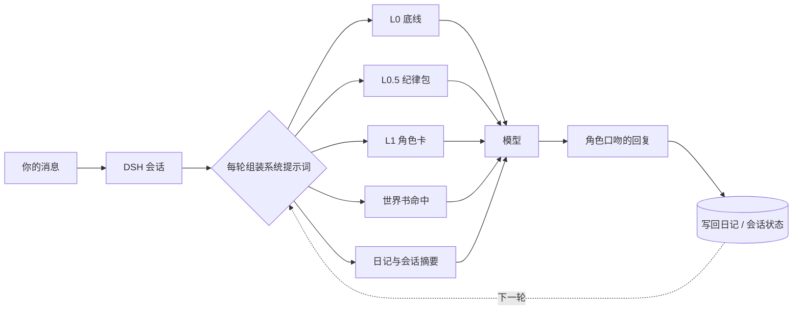

# dsh-ai-with-u

**给 DeepSeek Harness 的角色扮演插件。** 蒸馏任意ip角色卡并让你的大肥鱼成为TA，选一张角色卡点「启用」，人设立刻生效；点「退出」，干净拔出，正常工作不受影响。


<p align="center">
  
</p>

<p align="center">
  <sub>面板实拍：左侧角色簿，右侧是角色卡详情——34 个字段都可以就地编辑。</sub>
</p>

---

## 它是什么

一个 DSH 插件，负责三件事：**把角色卡注入系统提示词、维护角色的日记记忆、提供一个管理面板**。

自带完整的蒸馏系统，可指引大肥鱼联网收集资料，整理一张任意 IP 的角色卡并启用角色扮演——只要网上能搜到，就能蒸出来！
内置三张卡：Ave Mujica 的丰川祥子、明日方舟的阿米娅、崩坏的昔涟。
标准的酒馆卡格式，可导入现成酒馆卡，也可自制。

聊天本身仍然走 DSH 自己的会话——不做自定义聊天界面，不劫持消息流。插件只在「人设从哪来、记忆写到哪」这两个环节介入。

```
启用前：和普通 DSH 会话没有区别
启用后：模型以角色身份说话，但该跑测试跑测试、该读代码读代码
退出后：系统提示词里一个字都不留，和没装过一样
```

---

## 为什么会有它

原项目 [ai-with-u](https://github.com/Treasure-hub-agent/ai-with-u) 是一个 skill：角色卡、日记、时间差全有，但所有确定性逻辑都交给模型——建目录、读写 JSON、追加 markdown、算索引。模型得同时扮演角色和文件系统，出岔子是早晚的事。

这个插件把确定性部分收进代码，只把「怎么写台词」留给模型。

| | 原 skill | 本插件 |
|---|---|---|
| 提示词 | `SKILL.md` 13 KB，每轮全量注入 | 启用态约 2.8–3.3 KB（lite 档），不启用时为 0 |
| 文件读写 | 模型自己动手 | 插件代码保证，原子写 + 跨进程锁 |
| 角色管理 | 在对话里说指令 | 可视化面板 |
| 生效时机 | 一直生效 | 可插拔，退出即卸载 |

有两处是**故意不做**，别当成缺功能：

- **8 个场景的扮演测试**（原 skill 里那套「测一遍人设像不像」的用例）没搬。人像不像只能靠聊，靠脚本测不出来——能测的（提示词长度、字段完整性、世界书命中、导入解析）都已经进了自检，共八套。
- **`manifest` / `full_card` 不单独落文件**，收进 `card.json` 的 `extensions.aiwu` 里。CCv3 本身只有一份真相，再存一份清单等于制造两个会互相漂移的事实来源；要读清单就 `GET /character`。

---

## 它是怎么工作的



### 分层注入

| 层级 | 什么时候在 | 内容 | 体积 |
|---|---|---|---|
| **L0 底线** | 启用期间 | 优先级声明 + 扮演底线 | 约 365 字符 |
| **L0.5 纪律包** | 启用期间，按档位 | 禁止词库、消息形态、动作格式、输入识别、内容边界 | lite 555 / full 736 字符 |
| **L1 角色** | 启用期间 | CCv3 角色卡（声线优先）+ 时间差 + 最近日记 | 约 1.9–2.4K，随卡增长 |
| **世界书** | 命中才注入 | 关键词 / 常驻条目，预算 12 条 · 6000 字符 | 典型约 0.2K |
| **L2 长流程** | 工具按需 | 蒸馏、建卡向导 | 不进系统提示词 |

退出时五段全部返回空串，宿主会过滤掉——这是「干净拔出」的实现方式，不是靠删文件。

纪律包有三档：`off`（关掉）/ `lite`（默认）/ `full`（多一段「遮住名字也要猜得出是谁」的语态锚点 + 每 10 轮日记自检）。切档走 `POST /_dsh/ai-with-u/discipline`，偏好存在 `_active.json` 里，退出角色也保留。

### 插拔

- 启用状态落盘，重启 DSH 自动恢复
- `awu_*` 工具与角色同进同出：启用才挂载，退出即卸下
- 世界书按关键词命中，同一轮复用结果，不重复注入、不跨轮累积

---

## 界面

入口在左侧栏底部（与用量统计插件同席位）。展开态显示「角色管理 + 当前角色名」，收起态收成 36px 圆徽，点击弹出悬浮面板。

四个分区：

- **角色簿** — 卡片墙、导入角色卡、注入预览、详情页、完整编辑
- **日记** — 时间线、关键词搜索、按月折叠、导出 markdown、逐条改写、危险区
- **统计** — 角色数、记忆条数、对话轮次
- **指南** — 首次打开时的使用说明

**注入预览**在角色簿详情的「预览」入口：列出此刻真正会进系统提示词的五段（L0 底线 / L0.5 纪律包 / L1 角色 / 世界书 / 时间差），每段给段名与字符数，下面是逐段正文，最后给总字符数。它显示的是宿主那一刻的真实渲染结果（`GET /preview`，纯只读：不刷新缓存、不写盘），不是面板自己另算的一份——两套算法的预览迟早会和实际注入对不上。

日记页支持**记忆回顾**：关键词搜索（标题、正文、日期都能命中）、按月份折叠，以及把当前角色的日记导出成 markdown 文件（浏览器里直接下载，不经过宿主）。

角色簿左栏顶部并排两枚同级按钮：**蒸馏角色卡**（从作品里蒸一张）和 **自创角色卡**（从零写一张）。旁边是对话模式的胶囊「纯文本 / 文本 + 动作」，当前值高亮，点一下立刻生效——不需要先启用角色，因为模式是偏好不是角色属性。

自创角色卡填三格（名字 / 身份 / 一句话背景）就能落档。想省事就勾「让 AI 补全人设」：插件先把这张骨架卡存好，再把补全指令发到当前会话，AI 会先问你 3–5 个关键问题（声线、关系、雷区、称呼），然后按酒馆卡格式补齐人设、开场白和世界书。合理推断标 `[AI推断]`，推不出来的标 `[待补]`，不编造。

角色簿左栏还有「导入角色卡」，吃酒馆卡的三种形态：带立绘的 `.png`、`.charx` 压缩包、裸 `.json`。选完文件先出预览（识别到的名字、格式、全部 warnings），同名卡会提醒冲突并要二次确认；确认后才写盘，取消不落任何文件。文件上限 11 MB——base64 会膨胀 4/3，11 MB 传到宿主正好还在 16 MB 收包线内；带立绘的 PNG 卡常见 3–10 MB。

「世界书太大」不再拦导入，只给警告：世界书是**按需注入**的（12 条 / 6000 字预算），超大书不会把提示词撑爆，只是超出预算的条目进不去当轮上下文。真正没有预算、直进提示词的那五个原生字段（描述 / 性格 / 场景 / 系统提示 / 历史后指令）仍然有硬上限。

角色卡编辑器是 10 组 34 字段，第 11 个分区是**世界书**：条目名、关键词 / 副关键词（逗号分隔）、内容长文本（可全屏写）、常驻、优先级、插入顺序、逐条启用与上移下移。高级项里有位置（角色设定前 / 后）、大小写敏感、`selective`、正则。

顶部体检按**三档**给结论，「必须处理」的只有两种真正会失效的情况：

| 档 | 报什么 |
|---|---|
| **必须处理（error）** | 非常驻且没有关键词（永远命不中）、内容为空（注入了等于没注入） |
| **建议看（warn）** | 条数超过建议线（30 条）——不会报错，超出预算的条目这一轮不进提示词，去「被裁条目」看清单 |
| **知道就好（info）** | 偏长条目**聚合一条**（默认不逐条；单条超 3000 字才会单独点名，因为命中一次就挤掉别人）、共享关键词**聚合一条** |

**字数不是问题**：世界书按需注入，总量再大也只是命中变少，所以「总字数超出」这条提醒已整条删掉（v0.3 之前会报，纯噪音）。体检只提示，不拦保存。

编辑器里「声线基因」是灵魂字段：说话节奏、自称、口头禅、禁忌词、小动作。这些决定「听起来像不像他」，所以给了金色描边和独立徽记。

---

## 安装

### 前提

- DeepSeek Harness 桌面版（desktop profile）
- Node 22.19+ 或 24+
- 不需要编译 C++，零原生依赖

### 步骤

包已发布到 npm，可以跳过克隆直接装（装完仍要按第 3 步配 bundles）：

```bash
npm install dsh-ai-with-u
```

GitHub Packages 上也有同一版本（scoped 名，需要带 `read:packages` 的 token）：

```bash
npm install @treasure-hub-agent/dsh-ai-with-u --registry=https://npm.pkg.github.com
```

或者从源码构建：

```bash
git clone https://github.com/Treasure-hub-agent/dsh-ai-with-u.git
cd dsh-ai-with-u
npm install && npm run build
```

```powershell
# 建 junction（Windows 上不要用 ln -sfn，它会静默退化成目录拷贝）
New-Item -ItemType Junction `
  -Path "$env:USERPROFILE\.dsh\profiles\desktop\node_modules\dsh-ai-with-u" `
  -Target "<你的克隆路径>"
```

然后编辑 `~/.dsh/profiles/desktop/package.json`：

```jsonc
{
  "dependencies": {
    "dsh-ai-with-u": "link:<你的克隆路径>"
  },
  "dsh": {
    "profile": {
      "bundles": [
        // ...
        "dsh-ai-with-u"
      ]
    }
  }
}
```

最后重启 DSH。宿主不会热加载 `lib/index.js`。

> ⚠️ 不要在 profile 的 `cordis.patch.yml` 里手写插件行——包内 `cordis.patch.yml` 的 `bundle.patch` 会自动挂载，重复写只会干扰故障定位。

---

## 使用

1. 左侧栏底部点「角色管理」
2. 选一张卡点「启用」
3. 开个新会话，像给老朋友发消息一样聊
4. 不想玩了点「退出」

想换说话方式（要不要带 `（动作）`）不用回面板：角色簿左栏工具栏有「纯文本 / 文本 + 动作」两枚胶囊，点一下 `POST /mode` 立刻切；也可以在对话里让模型切（`awu_mode`）。

开箱自带三张范例卡（丰川祥子 / 阿米娅 / 昔涟，都由插件自己的蒸馏流程产出）。首次启用时幂等种入：`characters/` 已存在就跳过，不会复活你删掉的卡。

### 角色启用：两种作用域

「启用」有两种，互不覆盖：

| 作用域 | 管谁 | 动作 |
|---|---|---|
| **全局启用** | 所有**没绑定**的会话（以及子代理） | `POST /activate` |
| **当前会话启用** | 只绑这一个会话 | `POST /bind {name, sessionId}` |

**决议优先级（写死、可被断言）**：

```
会话绑定 > 全局启用 > 未启用
```

举例：全局启用阿米娅、当前会话绑定丰川祥子 → 这个会话是祥子，其它会话是阿米娅。
全局切换不会动任何已有绑定；取消绑定后该会话自动回落到全局。

**两条硬边界**（不是限制，是防串台）：

1. **绑定的卡被删掉 → 该会话视为「未启用」，绝不回落到全局**。
   否则你会以为在跟祥子聊、其实在跟阿米娅聊——这种「静默串台」比报错难查得多。重新绑定会自动解除这个状态。
2. **子代理固定用全局角色，不继承父会话的绑定**。
   子代理有自己的 agent/session 查不到绑定，于是自然走全局。这是设计选择：让子代理继承会让人设意外泄漏到工具链深处。

**面板怎么显示两态**：详情页把「启用」拆成两枚动作——「当前会话启用」和「全局启用」，状态条分行显示
「当前会话：X（已绑定）」与「全局：Y」。点两者都会就地提示影响范围（「只影响当前会话」/「所有未绑定会话」）。
拿不到会话标识时（面板不知道自己在哪个会话）「当前会话启用」会置灰并说明原因，**不会瞎猜一个 id 写进去**。

> 提示词级的隔离是真的：宿主每段提示词都能拿到当前 Agent，所以同一个插件可以按会话渲染不同角色。
> 技术细节（`PromptSection` 没有 `scope`、但 `text(context)` 里有 `agent`）写在 `docs/DEVELOPMENT.md` §十四。

### 兼容旧卡与酒馆卡

- **旧 34 字段卡**：直接放进 `characters/<名>/card.json`，读时自动归一成 CCv3，首次保存时才落成新格式并留下 `card.v1.bak.json`
- **酒馆卡导入**：支持 `.png`（`tEXt` / `iTXt` 的 `ccv3`、`chara` 段）、`.charx`（zip 里的 `card.json`）、裸 `.json`（CCv2 自动升到 V3）
- **世界书超限**：不再拒绝导入或保存，改为返回 warnings（实际字数 + 上限）并在预览里逐条列出。世界书按需注入，超出预算的部分不会进提示词——书是完整的，只是这一轮用不到那么多

### 酒馆卡兼容矩阵（SillyTavern 字段级）

一张真卡（CCv3、89 条世界书、98869 字）跑过一遍之后逐字段核对的结论。**「支持」= 功能真的生效**，不是「没报错」。

| ST 字段 / 特性 | 状态 | 说明 |
|---|---|---|
| `description` `personality` `scenario` `first_mes` `alternate_greetings` | ✅ 支持 | 原样保留并进 L1；开场白里的 `{{char}}` / `{{user}}` 按角色名展开 |
| `system_prompt` / `post_history_instructions` | ✅ 支持 | 前者作为「角色自带指令」进 L1（优先级低于系统提示词、高于角色描写），后者进收尾提醒 |
| `mes_example` | ✅ 支持（有截断） | 进 L1「示例对话」，单卡上限 1200 字，超出截断并告警 |
| `creator_notes` `tags` `creator` `character_version` `group_only_greetings` 等元字段 | ✅ 保留不丢 | 不参与注入；认不出的键进 `extensions.aiwu.legacy.extra`，一个字节都不丢 |
| `character_book`（89 条 / 9.8 万字这种规模） | ✅ 支持（按需注入 + 双预算） | 每轮命中上限 12 条 / 6000 字；`constant` 条目走**独立 allowance**；被裁的条目在面板体检里列名字、日志里也带名字 |
| `use_regex`（key 当正则） | ✅ 支持（带护栏） | 模式长度上限、只扫最近文本前 8000 字、明显灾难回溯的构造退化成字面量、坏正则不抛错（否则整轮对话进不去） |
| `secondary_keys` + `selective` | ✅ 支持 | 四值 `selectiveLogic`（AND_ANY / NOT_ALL / NOT_ANY / AND_ALL）；`selective:false` 时次级键不参与激活（与 ST 一致） |
| `position: before_char / after_char` | ✅ 支持 | 分两个区块注入：「先读这些设定」与「相关设定」 |
| `position` 写成数字（`0` / `1`）或 `'before'` / `'after'` | ✅ 支持 | 统一归一到 `before_char` / `after_char`（老 ST 导出常见数字写法） |
| `@D` 深度注入 / `position: 4` / `depth` / `role` | ❌ 不支持（**内容不丢**） | 不做按消息深度插槽：这类条目仍会注入，只是当普通设定摆（默认 after 块），导入时统计条数并告警 |
| `constant` | ✅ 支持（独立预算） | 常驻走自己的额度（默认 12000 字，卡级可覆盖），不再和关键词命中抢 6000 字。真卡实测 6 条有效常驻 9577 字，全部注入、0 条被裁 |
| `probability` | ✅ 支持 | **顶层 `probability` 优先**，没有再读 `extensions.probability`（两种写法都有卡在用）；稳定哈希，同一轮结果固定，不会每轮抖动 |
| `scan_depth` / `token_budget` | ✅ 支持 | 前者默认扫最近 4 条（近似 D0..Dn 槽），后者按 1 token ≈ 1.5 字换算成字符预算 |
| `recursive_scanning` | ❌ 不支持 | 字段认了但不执行：递归激活会放大预算与耗时，第一版明确不做 |
| `regex_scripts`（正则脚本） | 🛡 **屏蔽**（不执行 · 不注入 · 不影响对话，字段保留） | `data.regex_scripts` 与 `data.extensions.regex_scripts` 两个位置**都保留不删**（ST 卡是用户资产，删了将来导出/回灌会缺）；同时**可证明屏蔽**：脚本正文不会出现在 L1 或注入预览里，去掉脚本后提示词逐字相同。导入预览给中性提示「本卡含 N 条酒馆正则脚本，已屏蔽」。口径常量 `ST_SCRIPT_STANCE`，详见 `docs/DEVELOPMENT.md` §十三 / §十四 |
| `depth_prompt` | ❌ 不支持（**字段保留**） | `extensions.depth_prompt` 随卡保留、写入不丢，但不读、不注入；非空时导入会明确告警「深度提示暂不支持，字段已保留」。需要的话把内容放进世界书常驻条目 |
| `assets`（立绘） | ❌ 不支持 | 导入时剥离并告警：本轮不做立绘落地，卡片其余内容不受影响 |
| `@@activate` / `@@dont_activate` 装饰器 | ✅ 支持 | 影响该条目是否参与激活 |
| `@@depth` / `@@position` / `@@role` / `@@probability` / `@@cooldown` 装饰器 | ⚠️ 认识但不生效 | 已知装饰器会从正文剥掉（绝不注入正文），但不改变注入行为；未知 `@@xxx` 整行丢弃 |
| `extensions.match_whole_words` | ✅ 支持 | 打开后按整词匹配（汉字里不误命中子串） |

> 三条最容易踩的：**① `regex_scripts` 不是「支持但没用到」，是屏蔽**（DSH 侧没有可插入的渲染点，所以不执行、不注入，但字段保留）；
> **② 深度注入（`@D` / `position: 4`）不支持，但内容不丢**——按普通设定注入，只在位置上让步；
> **③ 世界书再大也不会整本注入**，这是设计而非缺陷。

### 文件拖放归谁管

**面板打开期间，文件拖放归面板处理。**

DSH 的聊天区有一个「文件或图片拖动到此处即可添加」的拖放区，它是文档级的：文件在页面任何位置松手，都会被它接住当附件。所以插件打开面板后会接管文件拖放：

- 拖进「导入角色卡」的虚线框 → 走导入预览（不写盘，确认才保存）
- 拖到面板里其它地方 → 提示「把卡拖到虚线框里」，**不放行给聊天区**
- 拖进面板之外（聊天区自己）→ 正常添加附件，插件不管

为什么这么较真：v0.3.0 真机上出现过「把角色卡拖到面板上，卡被当成附件发进了对话」。宁可拦下来给一句提示，也不能让卡文件混进聊天上下文。

> 插件同时会替聊天区复位它的拖放状态（拖完主动补一个 `dragend`）。所以关掉面板之后，聊天区的拖放应该和平时一样——如果你发现关面板后拖文件进聊天区没反应，那是 P0，请报。

---

## 数据存储

默认 `~/.dsh/ai-with-u/`，可用 `AIWU_STORAGE_ROOT` 覆盖：

```
~/.dsh/ai-with-u/
├── _index.json                # 角色索引
├── _active.json               # 当前启用状态（含 mode / discipline 偏好）
└── characters/<角色名>/
    ├── card.json              # CCv3 角色卡
    ├── card.v1.bak.json       # 迁移前原件，回滚就拷回来
    ├── diary.md               # 日记，按天分组
    └── session.json           # 会话状态与滚动摘要
```

`session.json` 是「这一册读到哪了」，认得这些字段：

| 字段 | 含义 |
|---|---|
| `recent` / `turn_count` / `last_ts` | 最近几轮、累计轮次、最后一次时间 |
| `mood` / `topic` | 此刻的情绪、未竟的话题（写日记时一并落盘，下一轮 L1 用） |
| `mode` | `text` 或 `text+action`，**交互模式的权威位置** |
| `intimacy` | 关系档位，五档之一：陌生 / 认识 / 熟悉 / 亲近 / 亲密 |
| `relation_log` | 档位变化留痕：`{ at, from, to, why? }`，最多 50 条，超出丢最旧 |

交互模式按 `session.json` → `_active.json` → `text+action` 的顺序解析：会话里用 `awu_mode` 切的档立刻生效，`_active.json` 只作没会话记录时的兜底。

纯 markdown / JSON，可读、可改、可备份、可迁移。不联网、不注册、不收藏数据。

### 接口安全

面板接口 `/_dsh/ai-with-u/*` 只接受本机来源：Host 必须是回环或实际监听地址，Origin 必须同源，`Sec-Fetch-Site: cross-site` 直接拒绝；写接口强制 `POST + application/json`。浏览器里任何网页都无法跨站触发删除或读取卡片。

如果确实要通过隧道/反代从别的域名访问本机 GUI，用环境变量显式放行：

```bash
AIWU_TRUSTED_HOSTS=my.tunnel.example
```

默认拒绝，不靠猜。

---

## 能力清单

### 模型工具（9 个，仅启用角色时挂载）

| 工具 | 用途 |
|---|---|
| `awu_diary_write` | 追加日记（可同时记下 `topic` / `mood`） |
| `awu_diary_read` | 读取 / 筛选日记 |
| `awu_whoami` | 查询当前身份 |
| `awu_forget` | 忘记某事（日记 + 会话 + 角色卡三处同步） |
| `awu_diary_edit` | 就地改写日记条目 |
| `awu_session_reset` | 全新开始 / 彻底重置 |
| `awu_relation` | 查关系档位依据；带 `set` 时按里程碑写回档位 |
| `awu_mode` | 切换纯文本 / 文本 + 动作 |
| `awu_opening_next` | 换一句开场 |

另有一个**条件挂载**的 `awu_card_save`：只在点「蒸馏角色卡」后的两小时内、且保存一次后自动失效。平时模型拿不到写卡能力。

### REST 接口（26 条，`/_dsh/ai-with-u/`）

```
overview  preview  characters  character  character/save  character/import  character/delete
activate  deactivate  bind  unbind  mode  discipline  relation  relation/set
opening/next  opening/state  diary/save  diary/edit  forget  session/reset  session/commit
distill/flow  distill/arm  distill/disarm  distill/state
```

`/character` 与 `/characters` 同时返回 `card`（34 字段视图）与 `ccv3`（完整卡）；`/character/save` 收 `{ name, card?, ccv3? }`，只给 `card` 时保留既有世界书与 `extensions`。

`/bind` 与 `/unbind` 就是「当前会话启用」：`POST /bind {name, sessionId}` / `POST /unbind {sessionId}`，返回 `{ ok, bound, character }`。`POST /activate` 仍然是**全局启用**语义（向后兼容）。`GET /overview?sessionId=…` 会带上 `sessionId`、`binding`（本会话绑了谁）与 `bindings` 摘要，面板据此判断「当前会话启用」能不能点。

`/character` 与 `/characters` 同时返回 `card`（34 字段视图）与 `ccv3`（完整卡）；`/character/save` 收 `{ name, card?, ccv3? }`，只给 `card` 时保留既有世界书与 `extensions`。

`GET /preview` 是**纯只读**快照：返回 `{ active, mode, discipline, segments[] }`，`segments` 永远五段（`id` / `order` / `label` / `chars` / `text`；未启用角色时 `text: ''`、`chars: 0`）。文本走 `PromptController` 的真实渲染路径，不在预览里另拼一份——拼第二份等于给「预览与真实注入漂移」开口子。

> 世界书的改动**必须随 `ccv3` 发**：只发 `card` 时后端以磁盘上的旧卡为底重投影，`character_book` 按原卡保留——改动会被静默吞掉，还会提示保存成功。

`awu_relation` 的口径是「**查看不写回**」：用户只是问「关系如何」时只读档位、不改档；只有里程碑事件（第一次约定、第一次争吵、称呼改变、表白）才带 `set` 写回，并在 `relation_log` 留一条。对话里不出现「好感度 +1」这类数值。

### 面板与提示词

- **注入预览** —— 五段真实渲染的段名 / 字符数 / 正文 + 总字符，纯只读快照
- **记忆回顾** —— 日记关键词搜索、按月折叠、导出 markdown
- **导入角色卡** —— 角色簿左栏入口，吃 PNG / CHARX / JSON，先预览后落盘；世界书超限只警告不拦
- **自创角色卡** —— 三格表单落骨架卡，可选「让 AI 补全人设」（走当前会话，AI 先问 3–5 个问题）
- **世界书编辑** —— 角色卡编辑器第 11 分区，条目增删改 + 体检
- **对话模式** —— 角色簿工具栏的「纯文本 / 文本 + 动作」胶囊，点了立刻生效，不需要启用角色
- **纪律包 L0.5** —— `off` / `lite` / `full` 三档，默认 lite，偏好落盘、退出角色也保留
- **`awu_mode`** —— 对话里直接切纯文本 / 文本 + 动作，不需要回面板

---

## 开发

```bash
npm run build            # 宿主 tsc + 前端 tsc + 打包 + 九套自检（合计 914 项）
npm run verify           # 产物形状 / 新鲜度 / 孤儿产物（15 项）
npm run verify:bundle    # 客户端产物加载（9 项）
npm run verify:wiring    # 接线体检：23 组契约（63 项；后端做了前端没接 / 验收项回归）
npm run verify:tavern    # 卡格式 / 迁移幂等 / 世界书预算 / ST 兼容（303 项）
npm run verify:distill   # 蒸馏 / 补全武装与 kind（121 项）
npm run verify:import    # PNG / CHARX / JSON 导入解析 / 字段保真（58 项）
npm run verify:session   # 会话、指令、纪律包、关系、绑定与预览只读（251 项）
npm run verify:host      # 真实 cordis 宿主装配（94 项）
npm run typecheck:client # 只查浏览器侧类型
```

`npm run build` 串的顺序是：`tsc`(宿主) → `tsc`(前端) → esbuild 打包 → `verify-bundle` → `verify-wiring` → `verify` → `verify-tavern` → `verify-distill` → `verify-import` → `verify-session` → `verify-host`。任何一项非 0 退出就整体失败。

徽章上的 914 = build 串里所有自检的通过项之和，失败项必须为 0、skip 也必须为 0（`bundle 9 + wiring 63 + verify 15 + tavern 303 + distill 121 + import 58 + session 251 + host 94`）。旧徽章的 515 用的是更窄的口径（只数六套，不含 `verify` 与 `verify-wiring`），所以数字变大不全是因为新增了断言。

`verify-wiring` 补的是其余七套查不到的盲区：**类型检查只问「类型对不对」，不问「有没有人调用」**。一个 17 KB 的世界书数据层可以零引用地躺在仓库里，一个 `POST /character/import` 可以注册完就没下文——这两种状态下 `tsc`、打包、其余自检全绿，但用户打开面板什么都看不到。脚本只做静态扫描（读源码找路由字符串与调用点），失败文案写清「缺什么 + 该找谁」。最后一组会把 `lib/prompt.js` 拿回来跟源码逐字比纪律包文本，抓「改了源码没重编」；产物不存在或比源码旧时跳过，不报红。

> 抽查 `lib/client.js` 时别用中文去 grep：esbuild 默认 `charset: ascii`，打包产物里的中文一律转成 `\uXXXX`（如「导入角色卡」= `\u5BFC\u5165\u89D2\u8272\u5361`）。功能无损，但**按字面搜中文会误判「产物里没有」**。

宿主 API 的类型直接来自 `@deepseek-ai/dsh-system-prompt` / `dsh-tools` / `cordis` 的 devDependencies，`inject`、`PromptSection`、`ToolDefinition` 都有编译期校验——契约漂移会在构建阶段报错，而不是运行时「failed 但不给原因」。

### 目录结构

```
src/            宿主侧：存储、提示词、工具、路由、格式层、导入、蒸馏
client/         浏览器侧：面板、编辑器、日记、指南、统计
scripts/        构建与自检
docs/           设计文档与开发记录（含踩坑大全）
presets/        开箱角色卡
tools/preview/  脱离宿主的面板预览沙盒
```

---

## 常见问题

<details>
<summary>会不会覆盖我 AGENTS.md 里的人设？</summary>

AGENTS.md 是以 user 角色消息注入的，插件用的是 system prompt，层级更高。L0 里显式写了边界：只让「我是谁、我怎么说话」，不让「我怎么做事」——代码规范、工程流程、安全约束照常生效。

</details>

<details>
<summary>退出后真的什么都不留吗？</summary>

五段（L0 / L0.5 纪律 / L1 / 世界书 / 时间差）在退出后都返回空串，宿主会过滤空段。`awu_*` 工具同时全部卸载。数据文件仍然在磁盘上，但不参与任何提示词组装。

</details>

<details>
<summary>为什么不能用 <code>dsh plugin</code> CLI 安装？</summary>

desktop profile 由 Electron 独占管理，CLI 会直接报 `managed exclusively by the Electron application`。按上面的 junction + profile 配置方式装。

</details>

<details>
<summary>删了角色，日记还在吗？</summary>

删除时可以选「只删卡」或「连记忆一起删」。只删卡时 `diary.md` 留在磁盘上，重新创建同名角色还能接上。

</details>

<details>
<summary>提示词到底占多少 token？</summary>

启用态约 2.8–3.3 KB 字符量级（中文按字计），未启用 0。实测：丰川祥子的卡 + lite 档，整段渲染 3286 字符。默认 lite 档的纪律包占 555 字符；切 `off` 全省，切 `full` 多 181 字符。世界书常态只注入一两百字符。重内容（卡里的详细设定、长日记）不会无条件进提示词。

</details>

<details>
<summary>为什么我的大卡能导入了，但设定只用得上一部分？</summary>

因为世界书是**按需注入**的，不是整本塞进提示词。命中预算默认 12 条 / 6000 字（`LORE_DEFAULTS`），超出预算的条目这一轮就不进上下文——卡本身一个字都没被改，磁盘上仍是完整的世界书，你在编辑器里能看到全部条目。

`constant: true` 的常驻条目走**独立额度**，不和关键词命中抢那 6000 字（真卡实测：7 条常驻共 10512 字，修之前有 2 条被静默挤掉，而常驻正是「必须一直生效」的那类）。

**哪里能看到被裁的条目**：打开角色卡编辑器 → 世界书分区顶部的体检行，会按等级列出「这一轮被预算裁掉的条目」；宿主日志里也会带条目名（只带名字，不写正文）。想提高命中率就把关键词写准、把常驻留给「必须一直生效」的设定。

这是刻意的：一张 9.8 万字的世界书全量注入，要么撑爆上下文、要么每轮烧掉一大笔费用，而真正用得上的往往只有当轮提到的那几条。

现在导入/保存这类大书只会出警告（附实际字数与上限），不再拦你——v0.3.0 之前这里是硬拦，属于过严。

</details>

<details>
<summary>为什么我的卡里正则（<code>regex_scripts</code>）不起作用？</summary>

因为**本插件不执行酒馆的正则脚本**，而且这不是「暂时没接」——是宿主侧没有可插入的点。

酒馆的 `regex_scripts` 有两类用法，我们分开说：

- **提示词侧**（发送前改写 prompt 文本）：能做但**没做**。理由很简单：它改的是发给模型的内容，属于「用户不知道自己在看什么」的黑箱，真出问题时极难排查。
- **显示侧**（收到回复后改写显示文本，比如把 `*笑*` 变成斜体、把某些词替换掉）：**做不了**。DSH 的客户端插槽 `conversation.chat.node` 只能**新增**聊天行，改不了已经渲染出来的助手消息；`agent/request` 钩子只管 provider / model / reasoningEffort 路由，不碰文本；插件规范也明写不许读写组件外的 DOM。

生态里的做法是把这个能力**交割出去**：`dsh-tavern` 从 2.7.x 起把显示层整块交给 `dsh-muv-engine`（自己那套渲染器删掉了，因为两边的 `beautifyContentEl` 会互相覆盖）。想用正则美化显示，装 muv 系引擎即可，本插件不重复造第二套。

**你的卡不会因此丢东西**：`regex_scripts` **原样保留**在卡里（`data.regex_scripts` 与 `data.extensions.regex_scripts` 两个位置都不动），只是不被执行。导入预览会给一条告警说清这一条——留着字段是为了你将来导出/回灌酒馆时不缺东西，「以为它在工作」则用告警解决，而不是删数据。

如果你依赖的是提示词侧的正则效果，请把规则改写进角色卡的 `system_prompt` 或世界书条目——那是我们能保证生效的地方。详见 `docs/DEVELOPMENT.md` §十三。

</details>

<details>
<summary>「当前会话启用」和「全局启用」有什么区别？</summary>

两个作用域，互不覆盖：

- **全局启用**：所有**没绑定**的会话都用它（还有子代理）。切换全局不影响任何已绑定会话。
- **当前会话启用**：只绑你点的这一个会话，别处照旧。

决议顺序写死：**会话绑定 > 全局启用 > 未启用**。所以「全局阿米娅 + 本会话祥子」= 这个会话是祥子、其余是阿米娅。

两条边界值得记住：

1. **绑的卡被删掉，那个会话就当作未启用，不会偷偷回落到全局**——否则你会以为在跟祥子聊、其实对面是阿米娅。重新绑定即可恢复。
2. **子代理固定用全局角色，不继承父会话绑定**：子代理有自己的身份查不到绑定，于是走全局。这是有意为之，防止人设意外漏进工具链。

面板上两态分行显示（「当前会话：X（已绑定）」/「全局：Y」），点哪个都会就地提示影响范围。如果面板拿不到会话标识，「当前会话启用」会置灰——它不会瞎猜一个 id 写进去。

</details>

<details>
<summary>面板说卡里有 N 条正则脚本、已屏蔽，会有什么影响？</summary>

**没有任何影响，而且这是可以验证的**：

- 脚本**不会被执行**（提示词侧与显示侧都不做）；
- 脚本正文**进不了提示词**：自检里拿一个特征串做标记，跑完整 L1 与「注入预览」，产物里搜不到它；
- 对注入**零影响**：同一张卡去掉 `regex_scripts` 后，L1 与预览的文本**逐字相同**；
- 字段**原样保留**：你将来把卡导出回酒馆，脚本还在。

换句话说，看到的角色表现与「这张卡本来就没有正则脚本」完全一致。如果卡的表现依赖这些脚本（比如靠正则把某些词换成斜体、或替换成别的台词），那部分效果不会出现——想保留效果就把它改写成角色卡的人设描述，显示层的正则美化需要装 muv 系引擎（本插件不做第二套渲染器，原因见 `docs/DEVELOPMENT.md` §十三）。

</details>

---

## 致谢

- 原项目：[ai-with-u](https://github.com/Treasure-hub-agent/ai-with-u)
- 角色卡格式：[Character Card V3](https://github.com/malfoyslastname/character-card-spec-v2)
- 宿主：[DeepSeek Harness](https://harness.deepseek.com)

## License

MIT
