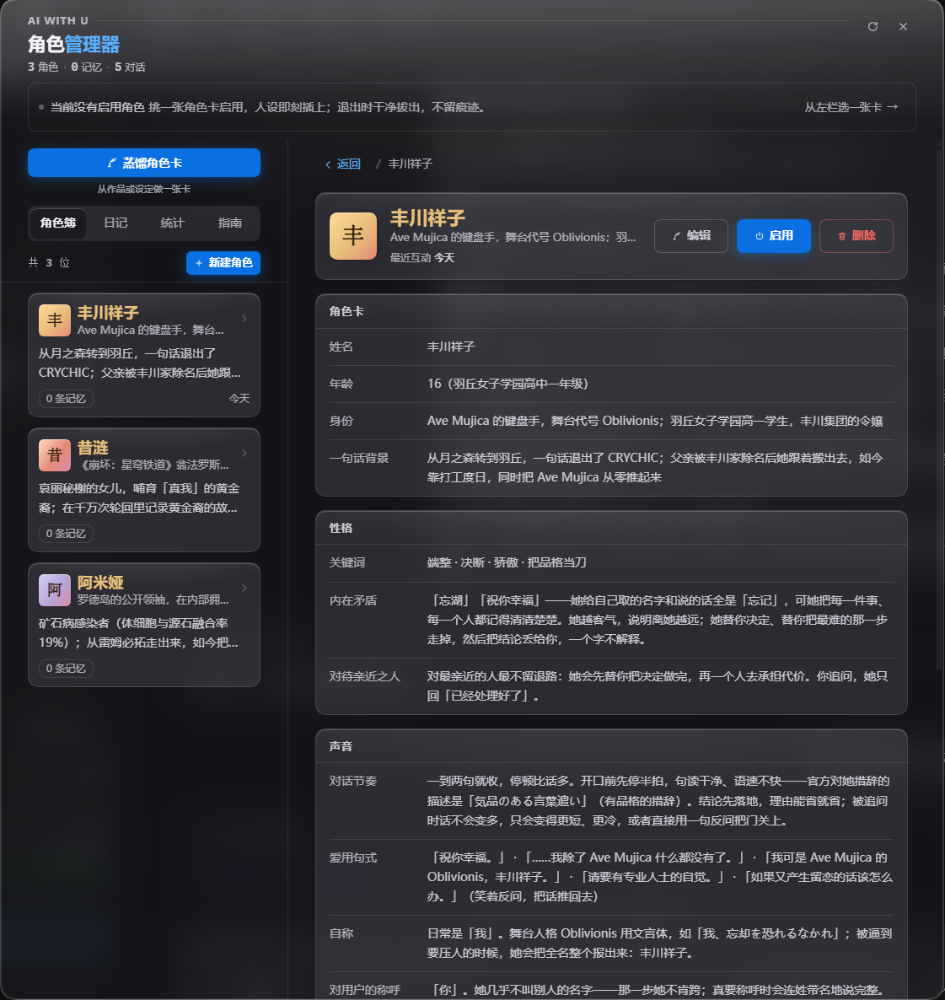
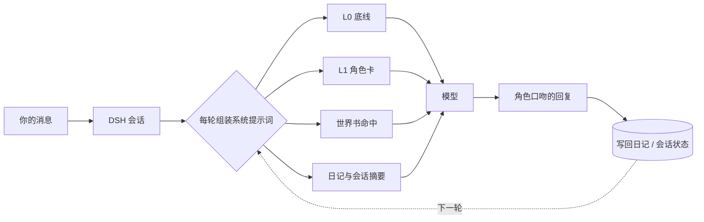

# dsh-ai-with-u

**给 DeepSeek Harness 的角色扮演插件。** 蒸馏任意ip角色卡并让你的大肥鱼成为TA，选一张角色卡点「启用」，人设立刻生效；点「退出」，干净拔出，正常工作不受影响。


<p align="center">
  
</p>

<p align="center">
  <sub>面板实拍：左侧角色簿，右侧是角色卡详情——34 个字段都可以就地编辑。</sub>
</p>

---

## 它是什么

一个 DSH 插件，负责三件事：**把角色卡注入系统提示词、维护角色的日记记忆、提供一个管理面板**。

自带完整的蒸馏系统，可指引大肥鱼联网收集资料，整理一张任意 IP 的角色卡并启用角色扮演——只要网上能搜到，就能蒸出来！
内置三张卡：Ave Mujica 的丰川祥子、明日方舟的阿米娅、崩坏的昔涟。
标准的酒馆卡格式，可导入现成酒馆卡，也可自制。

聊天本身仍然走 DSH 自己的会话——不做自定义聊天界面，不劫持消息流。插件只在「人设从哪来、记忆写到哪」这两个环节介入。

```
启用前：和普通 DSH 会话没有区别
启用后：模型以角色身份说话，但该跑测试跑测试、该读代码读代码
退出后：系统提示词里一个字都不留，和没装过一样
```

---

## 为什么会有它

原项目 [ai-with-u](https://github.com/Treasure-hub-agent/ai-with-u) 是一个 skill：角色卡、日记、时间差全有，但所有确定性逻辑都交给模型——建目录、读写 JSON、追加 markdown、算索引。模型得同时扮演角色和文件系统，出岔子是早晚的事。

这个插件把确定性部分收进代码，只把「怎么写台词」留给模型。

| | 原 skill | 本插件 |
|---|---|---|
| 提示词 | `SKILL.md` 13 KB，每轮全量注入 | 启用态约 2.4 KB，不启用时为 0 |
| 文件读写 | 模型自己动手 | 插件代码保证，原子写 + 跨进程锁 |
| 角色管理 | 在对话里说指令 | 可视化面板 |
| 生效时机 | 一直生效 | 可插拔，退出即卸载 |

---

## 它是怎么工作的



### 分层注入

| 层级 | 什么时候在 | 内容 | 体积 |
|---|---|---|---|
| **L0 底线** | 启用期间 | 优先级声明 + 扮演底线 | 约 365 字符 |
| **L1 角色** | 启用期间 | CCv3 角色卡（声线优先）+ 时间差 + 最近日记 | 约 1.9–2.4K，随卡增长 |
| **世界书** | 命中才注入 | 关键词 / 常驻条目，预算 12 条 · 6000 字符 | 典型约 0.2K |
| **L2 长流程** | 工具按需 | 蒸馏、建卡向导 | 不进系统提示词 |

退出时四段全部返回空串，宿主会过滤掉——这是「干净拔出」的实现方式，不是靠删文件。

### 插拔

- 启用状态落盘，重启 DSH 自动恢复
- `awu_*` 工具与角色同进同出：启用才挂载，退出即卸下
- 世界书按关键词命中，同一轮复用结果，不重复注入、不跨轮累积

---

## 界面

入口在左侧栏底部（与用量统计插件同席位）。展开态显示「角色管理 + 当前角色名」，收起态收成 36px 圆徽，点击弹出悬浮面板。

四个分区：

- **角色簿** — 卡片墙、详情页、完整编辑（10 组 34 字段）
- **日记** — 时间线、逐条改写、危险区
- **统计** — 角色数、记忆条数、对话轮次
- **指南** — 首次打开时的使用说明

编辑器里「声线基因」是灵魂字段：说话节奏、自称、口头禅、禁忌词、小动作。这些决定「听起来像不像他」，所以给了金色描边和独立徽记。

---

## 安装

### 前提

- DeepSeek Harness 桌面版（desktop profile）
- Node 22.19+ 或 24+
- 不需要编译 C++，零原生依赖

### 步骤

包已发布到 npm，可以跳过克隆直接装（装完仍要按第 3 步配 bundles）：

```bash
npm install dsh-ai-with-u
```

GitHub Packages 上也有同一版本（scoped 名，需要带 `read:packages` 的 token）：

```bash
npm install @treasure-hub-agent/dsh-ai-with-u --registry=https://npm.pkg.github.com
```

或者从源码构建：

```bash
git clone https://github.com/Treasure-hub-agent/dsh-ai-with-u.git
cd dsh-ai-with-u
npm install && npm run build
```

```powershell
# 建 junction（Windows 上不要用 ln -sfn，它会静默退化成目录拷贝）
New-Item -ItemType Junction `
  -Path "$env:USERPROFILE\.dsh\profiles\desktop\node_modules\dsh-ai-with-u" `
  -Target "<你的克隆路径>"
```

然后编辑 `~/.dsh/profiles/desktop/package.json`：

```jsonc
{
  "dependencies": {
    "dsh-ai-with-u": "link:<你的克隆路径>"
  },
  "dsh": {
    "profile": {
      "bundles": [
        // ...
        "dsh-ai-with-u"
      ]
    }
  }
}
```

最后重启 DSH。宿主不会热加载 `lib/index.js`。

> ⚠️ 不要在 profile 的 `cordis.patch.yml` 里手写插件行——包内 `cordis.patch.yml` 的 `bundle.patch` 会自动挂载，重复写只会干扰故障定位。

---

## 使用

1. 左侧栏底部点「角色管理」
2. 选一张卡点「启用」
3. 开个新会话，像给老朋友发消息一样聊
4. 不想玩了点「退出」

开箱自带三张范例卡（丰川祥子 / 阿米娅 / 昔涟，都由插件自己的蒸馏流程产出）。首次启用时幂等种入：`characters/` 已存在就跳过，不会复活你删掉的卡。

### 兼容旧卡与酒馆卡

- **旧 34 字段卡**：直接放进 `characters/<名>/card.json`，读时自动归一成 CCv3，首次保存时才落成新格式并留下 `card.v1.bak.json`
- **酒馆卡导入**：支持 `.png`（`tEXt` / `iTXt` 的 `ccv3`、`chara` 段）、`.charx`（zip 里的 `card.json`）、裸 `.json`（CCv2 自动升到 V3）

---

## 数据存储

默认 `~/.dsh/ai-with-u/`，可用 `AIWU_STORAGE_ROOT` 覆盖：

```
~/.dsh/ai-with-u/
├── _index.json                # 角色索引
├── _active.json               # 当前启用状态
└── characters/<角色名>/
    ├── card.json              # CCv3 角色卡
    ├── card.v1.bak.json       # 迁移前原件，回滚就拷回来
    ├── diary.md               # 日记，按天分组
    └── session.json           # 会话状态与滚动摘要
```

纯 markdown / JSON，可读、可改、可备份、可迁移。不联网、不注册、不收藏数据。

### 接口安全

面板接口 `/_dsh/ai-with-u/*` 只接受本机来源：Host 必须是回环或实际监听地址，Origin 必须同源，`Sec-Fetch-Site: cross-site` 直接拒绝；写接口强制 `POST + application/json`。浏览器里任何网页都无法跨站触发删除或读取卡片。

如果确实要通过隧道/反代从别的域名访问本机 GUI，用环境变量显式放行：

```bash
AIWU_TRUSTED_HOSTS=my.tunnel.example
```

默认拒绝，不靠猜。

---

## 能力清单

### 模型工具（8 个，仅启用角色时挂载）

| 工具 | 用途 |
|---|---|
| `awu_diary_write` | 追加日记 |
| `awu_diary_read` | 读取 / 筛选日记 |
| `awu_whoami` | 查询当前身份 |
| `awu_forget` | 忘记某事（日记 + 会话 + 角色卡三处同步） |
| `awu_diary_edit` | 就地改写日记条目 |
| `awu_session_reset` | 全新开始 / 彻底重置 |
| `awu_relation` | 查询关系档位依据 |
| `awu_opening_next` | 换一句开场 |

另有一个**条件挂载**的 `awu_card_save`：只在点「蒸馏角色卡」后的两小时内、且保存一次后自动失效。平时模型拿不到写卡能力。

### REST 接口（21 条，`/_dsh/ai-with-u/`）

```
overview  characters  character  character/save  character/import  character/delete
activate  deactivate  mode  relation  opening/next  opening/state
diary/save  diary/edit  forget  session/reset  session/commit
distill/flow  distill/arm  distill/disarm  distill/state
```

`/character` 与 `/characters` 同时返回 `card`（34 字段视图）与 `ccv3`（完整卡）；`/character/save` 收 `{ name, card?, ccv3? }`，只给 `card` 时保留既有世界书与 `extensions`。

---

## 开发

```bash
npm run build            # 宿主 tsc + 前端 tsc + 打包 + 七套自检
npm run verify           # 产物形状 / 新鲜度 / 孤儿产物
npm run verify:tavern    # 卡格式 / 迁移幂等 / 世界书 / 忘却（218 项）
npm run verify:import    # PNG / CHARX / JSON 导入解析（49 项）
npm run verify:session   # 会话、指令与来源栅栏（111 项）
npm run verify:host      # 真实 cordis 宿主装配（35 项）
npm run verify:distill   # 蒸馏武装与 TTL（93 项）
npm run verify:bundle    # 客户端产物加载（9 项）
npm run typecheck:client # 只查浏览器侧类型
```

宿主 API 的类型直接来自 `@deepseek-ai/dsh-system-prompt` / `dsh-tools` / `cordis` 的 devDependencies，`inject`、`PromptSection`、`ToolDefinition` 都有编译期校验——契约漂移会在构建阶段报错，而不是运行时「failed 但不给原因」。

### 目录结构

```
src/            宿主侧：存储、提示词、工具、路由、格式层、导入、蒸馏
client/         浏览器侧：面板、编辑器、日记、指南、统计
scripts/        构建与自检
docs/           设计文档与开发记录（含踩坑大全）
presets/        开箱角色卡
tools/preview/  脱离宿主的面板预览沙盒
```

---

## 常见问题

<details>
<summary>会不会覆盖我 AGENTS.md 里的人设？</summary>

AGENTS.md 是以 user 角色消息注入的，插件用的是 system prompt，层级更高。L0 里显式写了边界：只让「我是谁、我怎么说话」，不让「我怎么做事」——代码规范、工程流程、安全约束照常生效。

</details>

<details>
<summary>退出后真的什么都不留吗？</summary>

四段（L0 / L1 / 世界书 / 时间差）在退出后都返回空串，宿主会过滤空段。`awu_*` 工具同时全部卸载。数据文件仍然在磁盘上，但不参与任何提示词组装。

</details>

<details>
<summary>为什么不能用 <code>dsh plugin</code> CLI 安装？</summary>

desktop profile 由 Electron 独占管理，CLI 会直接报 `managed exclusively by the Electron application`。按上面的 junction + profile 配置方式装。

</details>

<details>
<summary>删了角色，日记还在吗？</summary>

删除时可以选「只删卡」或「连记忆一起删」。只删卡时 `diary.md` 留在磁盘上，重新创建同名角色还能接上。

</details>

<details>
<summary>提示词到底占多少 token？</summary>

启用态约 2.4 KB 字符量级（中文按字计），未启用 0。世界书常态只注入一两百字符。重内容（卡里的详细设定、长日记）不会无条件进提示词。

</details>

---

## 致谢

- 原项目：[ai-with-u](https://github.com/Treasure-hub-agent/ai-with-u)
- 角色卡格式：[Character Card V3](https://github.com/malfoyslastname/character-card-spec-v2)
- 宿主：[DeepSeek Harness](https://harness.deepseek.com)

## License

MIT
